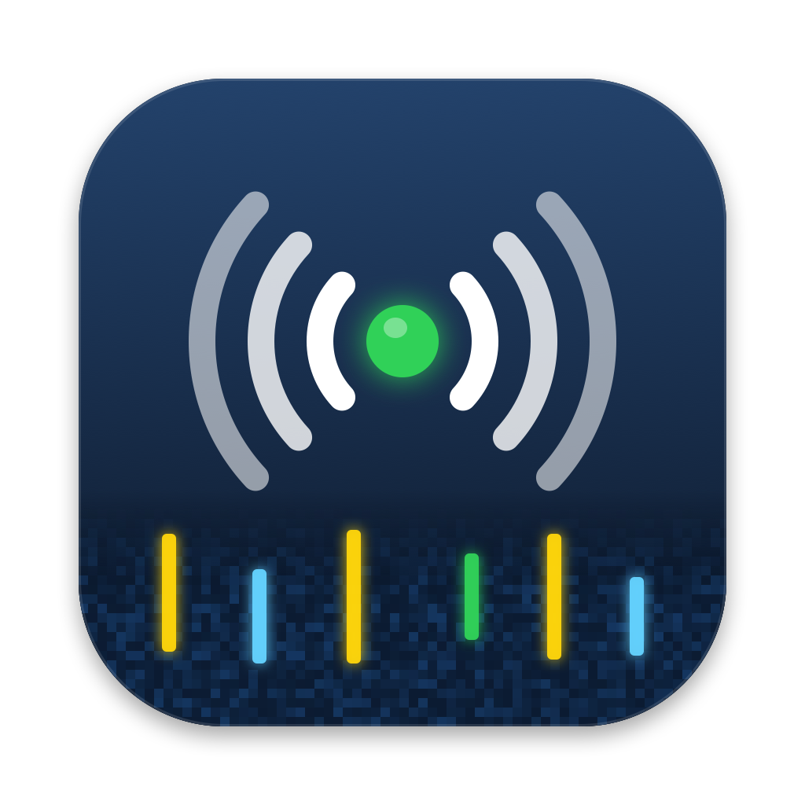

# FTX1 Status

A macOS menu bar app that checks why WSJT-X can't reach a Yaesu FTX-1. It refreshes every 5 seconds, and the menu bar icon turns green, yellow, or red.

Requires macOS 14 (Sonoma) or later and an FTX-1 connected over USB.

## What it checks

- **Radio on USB**: the FTX-1's CP2105 USB-serial chip (10C4:EA70).
- **CAT port**: which `/dev/cu.*` names map to interface 0 (Enhanced, CAT) and which to interface 1 (Standard, PTT). It also shows which driver owns each name.
- **CAT reply**: sends read-only queries (`ID;`, `FA;`, `MD0;`) and auto-detects the baud rate. It skips this while another app has the port open.
- **WSJT-X.ini**: checks that the configured port is the CAT interface, the baud rate matches the radio, and the configured audio devices are present.
- **WSJT-X link**: whether WSJT-X, or something else, has the CAT port open.

## Why the port keeps "disappearing"

The CP2105 has two serial ports, and two drivers can attach to both of them:

- **Apple's driver** names them `cu.usbserial-<USB serial number><n>`. These names stay the same across reboots.
- **The Silicon Labs driver** names them `cu.SLAB_USBtoUART`, `cu.SLAB_USBtoUART5`, and so on, in enumeration order. That order can change with power-on order.

When WSJT-X is pointed at a `SLAB_*` name, it will sometimes end up on the PTT port. Use `/dev/cu.usbserial-…0` at the radio's CAT RATE. The menu shows the rate the radio answered at.

## Install

    brew install --cask evil-wizard-corp/tap/ftx1-status

Or download the zip from [Releases](https://github.com/evil-wizard-corp/ftx1-status/releases). The app isn't notarized, because there's no paid Apple Developer account. The Homebrew cask clears the quarantine flag for you. If you install from the zip and macOS blocks the app, run `xattr -dr com.apple.quarantine "/Applications/FTX1 Status.app"`, or use System Settings → Privacy & Security → Open Anyway.

## Using it

Click the antenna icon in the menu bar to see each check, the radio's serial ports, and the WSJT-X settings it found.

- **Refresh** re-runs the checks now.
- **Probe now** queries the radio even while WSJT-X is running. Use it when WSJT-X is open but can't connect. It still won't touch a port another app has open.
- **Copy diagnostics** copies a text report for a bug report or a forum post. It includes your radio's USB serial number and your audio device names, so look it over before posting it publicly.
- **Apply to WSJT-X.ini** appears when the app knows a better port or baud rate. It rewrites `CATSerialPort` and `CATSerialRate` in the active configuration, and saves a timestamped backup (`WSJT-X.ini.bak-…`) next to the file first. It only runs while WSJT-X is closed, because WSJT-X overwrites the file when it quits.
- **Launch at login** starts the app when you log in. macOS may ask you to allow it in System Settings → General → Login Items.

From a terminal, `"/Applications/FTX1 Status.app/Contents/MacOS/FTX1Status" --dump` prints the same diagnostics and exits.

### How it stays out of WSJT-X's way

Querying a serial port changes its baud rate for every app using it, so the app is careful about when it probes:

- It never opens a port that another app has open, under either its `cu.*` or `tty.*` name. If it can't tell, it doesn't probe.
- It doesn't probe on its own while WSJT-X is running. It checks again before each baud rate it tries, so it stops if WSJT-X starts mid-probe.
- After a good reply it reuses the result for 60 seconds, and after a failure for 15 seconds, unless the radio's ports change.
- It only ever opens the CAT (Enhanced) port, never the PTT (Standard) port.

The app makes no network connections. Besides its own preferences (the last baud rate that worked) and the login item, it writes only WSJT-X.ini and a backup next to it, and only when you click Apply.

If WSJT-X talks to the radio through flrig or Hamlib's rigctld, the app expects that program to have the CAT port open and skips the serial port and baud checks.

## Build from source

You need Xcode, or the Xcode Command Line Tools for building only.

    ./build-app.sh --install   # builds build/FTX1 Status.app and copies it to ~/Applications
    swift test                 # evaluation, parsing, and lsof tests (needs Xcode)

`swift run FTX1Status --dump` prints the diagnostics from a source checkout.

## Releasing

Releases are automatic. Every commit needs a [conventional commit](https://www.conventionalcommits.org/) subject, and a check on each PR enforces this, for both the commits and the PR title. When something lands on `main`, the Auto release workflow works out the next version from the commits since the last release:

| Commit | Release |
| --- | --- |
| `fix: …`, `perf: …` | patch (0.2.0 → 0.2.1) |
| `feat: …` | minor (0.2.0 → 0.3.0) |
| `feat!: …`, or a `BREAKING CHANGE:` footer | major (minor before 1.0) |
| `docs:`, `ci:`, `chore:`, `refactor:`, `test:`, `build:`, `style:`, `revert:` | none |

The release workflow then:

1. runs the tests
2. builds a universal (arm64 + x86_64) app
3. tags the commit and creates a GitHub release with the zip attached
4. bumps the cask in [evil-wizard-corp/homebrew-tap](https://github.com/evil-wizard-corp/homebrew-tap)

To release when the commits don't call for one, run **Auto release** from the Actions tab and pick a bump. To ship a pre-release, push a tag with a hyphen by hand, like `git tag v0.3.0-beta.1 && git push origin v0.3.0-beta.1`. Pre-releases skip the cask bump, and the version math ignores them.

`scripts/next-version.sh` prints the version the next release would get.

## License

MIT — see [LICENSE](LICENSE).
